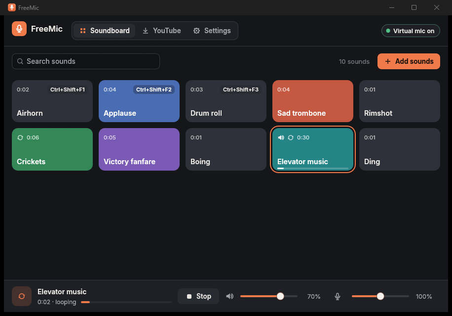

# FreeMic

FreeMic is a small soundboard with a built-in virtual microphone. Your real
microphone and the soundboard are mixed together and sent to a virtual
microphone. In Discord, a game or any other program you pick that virtual
microphone, and people hear your voice and your sounds together.

- Windows 11 and 10 (64-bit), Debian/Ubuntu and Arch Linux (x86-64);
  tested on Windows 11, Debian 12/13 and Arch (see [docs/TESTING.md](docs/TESTING.md))
- One small native program (Rust); measured 0.02–0.34 % of total CPU while running
- Free and open source (MIT)



## Features

- Button grid: import MP3, WAV, OGG (Vorbis), FLAC and M4A (AAC/ALAC) by
  clicking **Add sounds** or by dropping files onto the window.
- **Sounds from YouTube**: search YouTube (or paste a link) on the YouTube
  page and add the audio of one video to the board. Music search works like
  [YT-Downloader](https://github.com/VVVULTURE/YT-Downloader). The audio is
  stored locally; playlists are never downloaded. Uses
  [yt-dlp](https://github.com/yt-dlp/yt-dlp), fetched from its official
  releases on first use and checked against its published SHA-256.
- Click a button to play it, and click it again to stop it. **Stop** (or a
  hotkey) stops everything.
- Only one sound plays at a time. Starting a new sound replaces the current
  one immediately, with a 3 ms crossfade so there's no click.
- Per sound: **Play once** or **Loop until stopped**, rename, color, hotkey,
  replace the audio file, move, remove. Drag buttons to reorder them.
- Your microphone is mixed in live. Soundboard, microphone and output
  volumes are set separately, there's a mute switch for the microphone, and
  a peak limiter stops the mix from clipping.
- Optional monitoring sends only the soundboard (never your microphone) to a
  device you choose, e.g. your headphones. It's off by default, so FreeMic
  never plays through your speakers unless you ask it to.
- Global hotkeys (Windows, and Linux on X11). On Wayland, and for Stream Deck or
  scripts, use `freemic --play "Name"` and `freemic --stop`.
- Dark and light themes, a layout that adapts to any window from 480 × 400
  up, and automated checks that no text overlaps or is cut off at any size.
- Settings are saved automatically. If an audio device disappears, FreeMic
  recovers when it comes back. Sound files are copied into FreeMic's own
  library, so moving the originals doesn't break your board.

## How the virtual microphone works

| | Windows | Linux |
|---|---|---|
| Virtual mic provided by | [VB-CABLE](https://vb-audio.com/Cable/) (free, signed driver by VB-Audio, installed once, needs admin) | your sound server (PulseAudio, or PipeWire with `pipewire-pulse`); nothing to install |
| FreeMic plays into | `CABLE Input` | its internal sink `FreeMic Mixer (internal)` |
| In Discord/games select | **CABLE Output (VB-Audio Virtual Cable)** | **FreeMic Virtual Microphone** |
| Exists | permanently once the driver is installed | while FreeMic runs; removed on exit |

Windows only lets kernel drivers create microphones, and an unsigned driver
won't load, so FreeMic can't create one itself. It uses VB-CABLE and finds it
automatically. VB-CABLE isn't bundled (its license doesn't allow
redistribution). The installer, or **Settings → Download and install
VB-CABLE…**, downloads it from vb-audio.com, checks its digital signature and
starts VB-Audio's own installer, which asks for administrator approval. See
[docs/ARCHITECTURE.md](docs/ARCHITECTURE.md) for the details.

## Install

Download the file for your system from the
[latest release](https://github.com/VVVULTURE/FreeMic/releases/latest).

| Platform | Download | Notes |
|---|---|---|
| Windows | `FreeMic-0.2.0-windows-setup.exe` | Per-user install, no admin needed for FreeMic itself. Can also set up VB-CABLE. |
| Windows portable | `FreeMic-0.2.0-windows-portable.zip` | Unzip and run `FreeMic.exe`. Settings stay in the folder. VB-CABLE still has to be installed separately. |
| Debian 12+ / Ubuntu 22.04+ | `freemic_0.2.0-1_amd64.deb` | `sudo apt install ./freemic_0.2.0-1_amd64.deb` (tested on Debian 12 and 13) |
| Arch Linux | `PKGBUILD` + `freemic-0.2.0.tar.gz` | `makepkg -si` in the folder with both files |
| Linux portable | `freemic-0.2.0-linux-x86_64.tar.gz` | Extract and run `./freemic` (glibc 2.35 or newer). |

Step-by-step instructions, uninstalling and cleanup are in
[docs/INSTALL.md](docs/INSTALL.md).

## Quick start

1. Start FreeMic. On Windows, if no VB-CABLE is found, the Settings page
   tells you how to set it up.
2. Add sounds (**Add sounds**, drag and drop, or the **YouTube** page).
3. In Discord (Settings → Voice & Video → Input Device) or your game, choose
   **CABLE Output** (Windows) or **FreeMic Virtual Microphone** (Linux).
4. Click a button. The other people hear the sound together with your voice.

More details are in the [user guide](docs/USER-GUIDE.md).

## Command line

```
freemic --play "Airhorn"   play (or stop, if it is playing) a sound by name, or "#3" for the 3rd button
freemic --stop             stop the soundboard
freemic --quit             close FreeMic
freemic --minimized        start minimized
```

These commands control the FreeMic that's already running (named pipe on
Windows, Unix socket on Linux; local user only).

## Known limitations

- **Windows needs VB-CABLE.** Installing it needs administrator rights, and
  Windows sometimes asks for a restart. The portable version can't install
  drivers without that approval either.
- Ogg **Opus** files aren't supported (FreeMic shows an error). Convert them
  to OGG Vorbis, MP3 or FLAC.
- Global hotkeys don't work on **Wayland**, because Wayland doesn't let apps
  grab keys. Bind keys in your desktop's settings to `freemic --play "Name"`
  instead.
- On Linux the virtual microphone exists only while FreeMic runs. If FreeMic
  crashes, the leftover devices are removed the next time it starts.
- One sound at a time, by design.
- The YouTube page needs an internet connection, downloads yt-dlp (about
  24 MB on Windows, 41 MB on Linux) the first time, and saves YouTube's AAC
  audio as is (no conversion). Videos without an AAC stream can't be added.
  YouTube occasionally blocks automated downloads; FreeMic retries with other
  player clients and keeps yt-dlp up to date.

Also see [docs/TROUBLESHOOTING.md](docs/TROUBLESHOOTING.md).

## Documentation

- [docs/INSTALL.md](docs/INSTALL.md): install, portable use, uninstall and cleanup on every platform
- [docs/USER-GUIDE.md](docs/USER-GUIDE.md): using the soundboard, settings, hotkeys, where data is stored
- [docs/ARCHITECTURE.md](docs/ARCHITECTURE.md): design, technology choices, audio routing
- [docs/TROUBLESHOOTING.md](docs/TROUBLESHOOTING.md)
- [docs/BUILDING.md](docs/BUILDING.md): building from source and making the packages
- [docs/TESTING.md](docs/TESTING.md): test procedures and results
- [docs/CHECKLIST.md](docs/CHECKLIST.md): what is implemented and how it was verified

## License

MIT, see [LICENSE](LICENSE). Third-party components and their licenses are
listed in [THIRD-PARTY-NOTICES.md](THIRD-PARTY-NOTICES.md).
