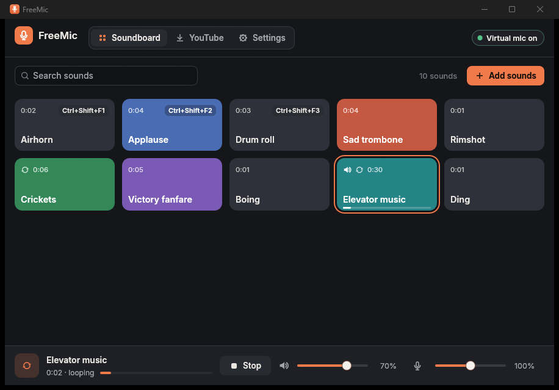
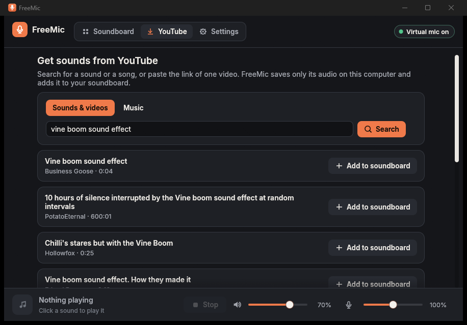
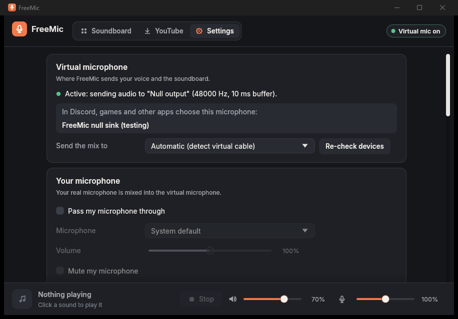

# FreeMic user guide



## The idea

```
 your microphone ──┐
                   ├─► FreeMic mix ─► virtual microphone ─► Discord / game / OBS
 soundboard ───────┘          (limiter)
```

Other programs never use your real microphone directly. They use the
virtual microphone, which carries your voice plus whatever the soundboard
plays. Select it once as the input device in each program:

- **Windows:** `CABLE Output (VB-Audio Virtual Cable)`
- **Linux:** `FreeMic Virtual Microphone`

## The window

| Part | What it shows |
|---|---|
| Top bar | the **Soundboard**, **YouTube** and **Settings** pages, and a status pill on the right: **Virtual mic on** (green), **Set up virtual mic** (red) or **Starting…**. Hover it to see the microphone name to pick in other programs; click it to open Settings. |
| Page | the sound buttons, the YouTube page or the settings |
| Bottom bar | the sound that's playing (name, time, progress), **Stop**, the soundboard volume, the microphone mute button and the microphone volume |

The window can be as small as 480 × 400. In narrow windows the bottom bar
uses two rows and the top bar shortens its labels (hover the icons to see
them); nothing is hidden or overlaps. Every page scrolls when it doesn't fit.

## Adding sounds

- Click **Add sounds** and choose one or more files, or drag files from
  your file manager onto the window.
- Or get a sound or song from YouTube: see [Getting sounds from YouTube](#getting-sounds-from-youtube).
- Supported: MP3, WAV (8/16/24-bit, 32-bit float, 8–96 kHz, mono to 5.1),
  OGG Vorbis, FLAC, M4A/MP4/AAC (AAC-LC and ALAC). Files are converted to the
  output's sample rate as they play. Surround files are mixed down to stereo.
- Not supported: Ogg **Opus**, WMA, and DRM-protected files. FreeMic tells
  you which files it couldn't import and why.
- By default the files are **copied** into FreeMic's library, so the
  soundboard keeps working if you move or delete the originals. Turn this
  off in Settings → General if you'd rather keep only links.

## Playing

| Action | How |
|---|---|
| Play a sound | Click its button, or press its hotkey |
| Stop it | Click the playing button again, or **Stop**, or the stop hotkey |
| Play another one | Click it: the current sound stops at once (short fade) and the new one starts |

Only one sound plays at a time. The playing button gets an orange outline, a
speaker icon and a progress line along its bottom edge, and the bottom bar
shows its name, time and progress.

Each button shows the sound's length in its top-left corner and its hotkey
(if any) in the top-right corner. Long names wrap onto up to three lines and
end with "…" if they still don't fit; hover a button to see the full name.

Each sound has a mode (right-click → **Play once** / **Loop until
stopped**). Looping sounds show a loop icon and repeat seamlessly until
you stop them. **Settings → General → New sounds play** sets the mode for
newly added sounds.

## Organizing

Right-click a button for:

- **Rename…**
- **Play once / Loop until stopped**
- a color (or **Default color**)
- **Set hotkey… / Clear hotkey**
- **Replace audio file…**: keeps the button, name, color and hotkey
- **Move left / Move right**: or simply drag the button to a new place
- **Remove…**: asks first; the copied file is deleted from the library

The **Search sounds** box above the buttons filters them by name (dragging
is turned off while searching). **Settings → General → Button size** sets the
smallest button width; the buttons stretch to fill each row.

## Volumes

| Control | Where | Range | Affects |
|---|---|---|---|
| Soundboard (speaker icon) | bottom bar, Settings → Levels | 0–100 % | soundboard level in the mix |
| Microphone (mic icon) | bottom bar, Settings → Your microphone | 0–200 % | your voice level in the mix |
| Virtual mic output | Settings → Levels | 0–100 % | the whole mix |
| Monitor volume | Settings → Hear the soundboard yourself | 0–100 % | only what you hear |

All volumes are saved. The sliders follow a loudness-like curve (50 % is
about −12 dB). Sliders can be dragged, clicked, or moved with the arrow
keys (Shift for steps of 10). The microphone button in the bottom bar mutes
your voice while sounds keep playing (it turns red while muted).

The **Levels** section shows live meters for microphone, soundboard and
output. A peak limiter keeps the mix just below full scale so it never
clips. If it has to work hard, Settings shows "The peak limiter is
preventing clipping"; lower a volume then, because heavy limiting sounds
squashed.

## Your microphone

**Settings → Your microphone**:

- **Pass my microphone through**: on by default.
  Turn it off to send only the soundboard.
- **Microphone**: `System default` follows your Windows/desktop default
  microphone, or choose a specific one. The virtual microphone itself is
  never offered here, which prevents feedback loops.
- The line below shows the device, its sample rate and FreeMic's buffer
  size. FreeMic keeps about 30 ms of buffer for your voice and corrects
  small clock differences between the microphone and the output, so the mix
  stays in sync even after hours.

If you chose a specific microphone and it's unplugged, your voice drops out
of the mix, the soundboard keeps working, and FreeMic reconnects when that
microphone comes back. It doesn't switch to a different microphone on its
own. With `System default`, FreeMic follows whatever your system's default
microphone is.

## Getting sounds from YouTube



The **YouTube** page saves the audio of a YouTube video on your computer and
adds it to the soundboard. It brings the search and download logic of
[YT-Downloader](https://github.com/VVVULTURE/YT-Downloader) into FreeMic.

**First use.** Click **Set up YouTube downloads**. FreeMic downloads
[yt-dlp](https://github.com/yt-dlp/yt-dlp), the free, open-source downloader
YT-Downloader is built on, from yt-dlp's official GitHub releases (about
24 MB on Windows, 41 MB on Linux), checks it against the SHA-256 checksum
published with that release, and keeps it in FreeMic's data folder
(`tools/`). Nothing is installed system-wide. FreeMic checks for a newer
yt-dlp at most every 6 hours, and only while you use the YouTube page.

**Sounds & videos.** Type what you're looking for (e.g. `vine boom`) and
press **Search**, or paste a video link and press **Get video**. Up to 10
results are listed with channel and length. **Add to soundboard** downloads
that one video's audio.

**Music.** Fill in **Artist**, **Song** or both and press **Find song**.
This is YT-Downloader's music search: it searches `artist song` (or
`'artist' official music video`, or `'song' song official`), and ranks the
results by how closely the title matches the song, whether the channel is
the artist's (or VEVO), and it ranks live, cover, karaoke and similar
versions lower. The top result is marked **Best match**.

**Only ever one video.** FreeMic never downloads a playlist:

- A link to a video inside a playlist or mix (`watch?v=…&list=…`) is reduced
  to that one video, and FreeMic says so.
- Links to playlists, channels or other pages are refused with an
  explanation.
- yt-dlp only ever receives a plain `watch?v=<id>` link, with `--no-playlist`
  and `--max-downloads 1`, and FreeMic ignores any yt-dlp configuration files
  on your computer.

**What's saved.** The audio is saved as an AAC `.m4a` file (no conversion
needed, so no ffmpeg) in `sounds/youtube/<video id>.m4a` inside FreeMic's
data folder, and the button is named after the video's title (rename it as
usual). Removing the button deletes the file. If you add the same video
again, FreeMic reuses the file instead of downloading it twice.

**Cancel** stops a search or download right away. **Settings → YouTube
downloads** shows the yt-dlp version, checks for an update, removes yt-dlp,
or opens the downloads folder.

Only download audio you have the right to use.

## Hearing the soundboard yourself (monitoring)

Off by default. **Settings → Hear the soundboard yourself → Monitor on**:
pick your headphones. Only the soundboard is played there, **never your own
microphone**, so there's no echo of your voice. FreeMic never plays anything
to a device you didn't pick here.

## Hotkeys

- Per sound: right-click → **Set hotkey…**, then press the combination.
  Letters, digits and most other keys need Ctrl, Alt or Shift (so typing in
  a chat can't trigger sounds). F1–F20, Insert, Home, End, Page Up and Page
  Down can be used alone. Escape cancels.
- Stop all sounds: **Settings → Hotkeys → Stop all sounds → Set…**
- Hotkeys work while other programs and games have focus. If a combination
  is already taken by another program, Settings says so; choose another.
- **Wayland (Linux):** programs can't grab global keys there. Bind keys in
  your desktop's keyboard settings to commands instead:

  ```
  freemic --play "Airhorn"     # by name, or --play "#3" for the third button
  freemic --stop
  ```

  `--play` on a sound that's already playing stops it, like clicking. The
  same commands work on Windows and X11, for example from a Stream Deck or
  AutoHotkey.

## Virtual microphone settings



**Settings → Virtual microphone** shows where the mix goes and which name
other programs should select.

- **Windows:** `Automatic (detect virtual cable)` uses VB-CABLE's `CABLE
  Input`. If no cable is installed, the page explains how to set one up and
  offers **Download and install VB-CABLE…**. You can also choose any output
  device by hand, for example another virtual cable. **Re-check devices**
  looks again after you've installed a driver.
- **Linux:** FreeMic creates the virtual microphone itself through
  PulseAudio/PipeWire when it starts, and removes it when it quits.

## General settings

- **Theme**: System (follows your desktop), Dark or Light.
- **Start FreeMic when I sign in (minimized)**: Windows registry Run entry,
  or `~/.config/autostart/freemic.desktop` on Linux.
- **Open data folder / Open log file**: useful for backups and bug reports.

## Data, backup and moving to another PC

Everything is in one folder (see [INSTALL.md](INSTALL.md#where-freemic-stores-data)):
`settings.json`, `soundboard.json`, `sounds/` (including `sounds/youtube/`)
and `tools/` (yt-dlp, if you used the YouTube page). To back up or move your
soundboard, copy that folder while FreeMic is closed. With the portable
version, just copy the whole FreeMic folder.
